# Penetration Testing Report - Mediroza General Hospital

**Target:** https://medirozahospital.com

**Date:** 27 November 2026

**Tester:** Siddhartha Gautam

**Batch:** B084 - NETWORKWALKS Cybersecurity Internship

## 1. Security Assessment

VAPT was performed on `medirozahospital.com` as part of the Week 4 capstone project.

During which I found a total of **9 findings** in which **3 CRITICAL** issues related to exposed sensitive directories, exposed database backup, and SQL Injection were thoroughly observed.

It was also found that the website uses a custom CMS `Mediroza CMS 1.4.2` on a `LiteSpeed` server. 

P1 level impact was achieved during **M3 - Sensitive Data Exposure**. Here, an old database backup file was publicly downloaded from the `/old/` directory, exposing confidential staff salaries and shareholder records.

---

## 2. Methodology & Tools Used

**M1 - Initial Access / Reconnaissance:**
- `whois` - Domain Registration Info
- `curl` - Header & Response Analysis
- `wafw00f` - WAF Detection
- `whatweb` - Technology Fingerprinting
- `subfinder` - Subdomain finding
- `Zenmap / Nmap` - Network Scanning (Several ports open at 199.188.201.16)

**M1 - Authentication Bypass:**
- SQL Injection Testing - Patient Portal Login

**M2 - Cracking / Post-Exploitation:**
- PDF Hash Extraction & Password Cracking - Patient Reports (NetworkWalk Tools Used)

**M3 - Sensitive Data Exposure:**
- Directory Enumeration - Gobuster - `/old/` Directory Discovery
- Database Backup Analysis - `.sql` File Review
- Staff Salaries Extraction
- Shareholder Details Extraction

All tests performed were under supervision and done for learning purposes only.

---
## 3. Evidences

1. WHOIS
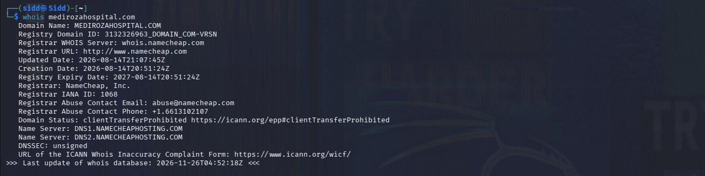

2. WHOIS 2
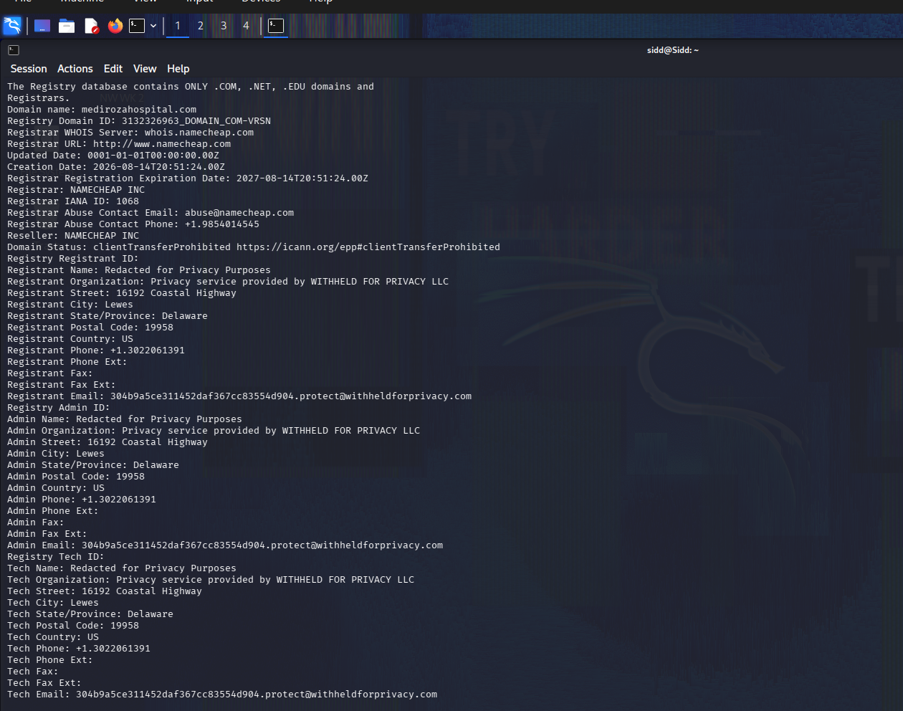

3. WhatWeb
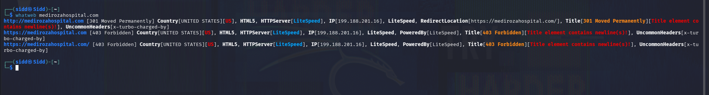

4. WAFW00F
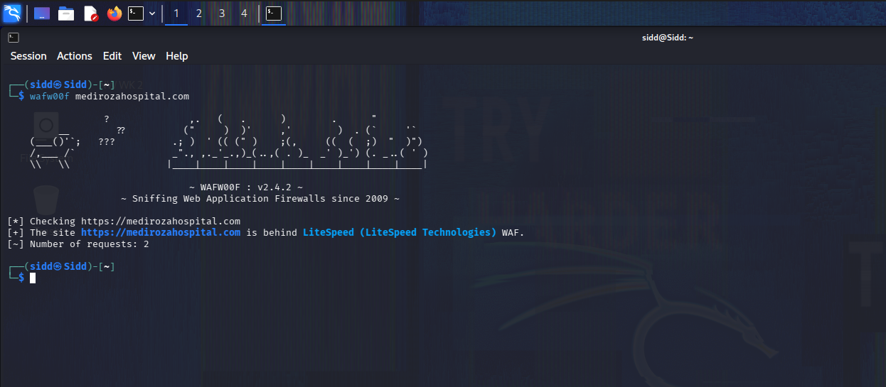

5. Subfinder
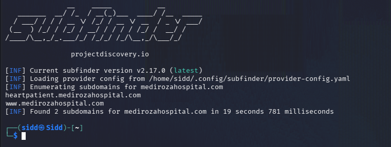

6. Curl
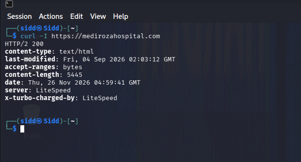

7. Mediroza Old
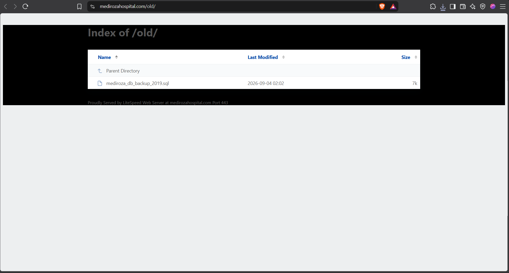

8. Mediroza Staff
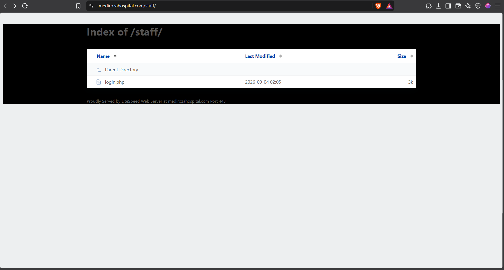

9. Database
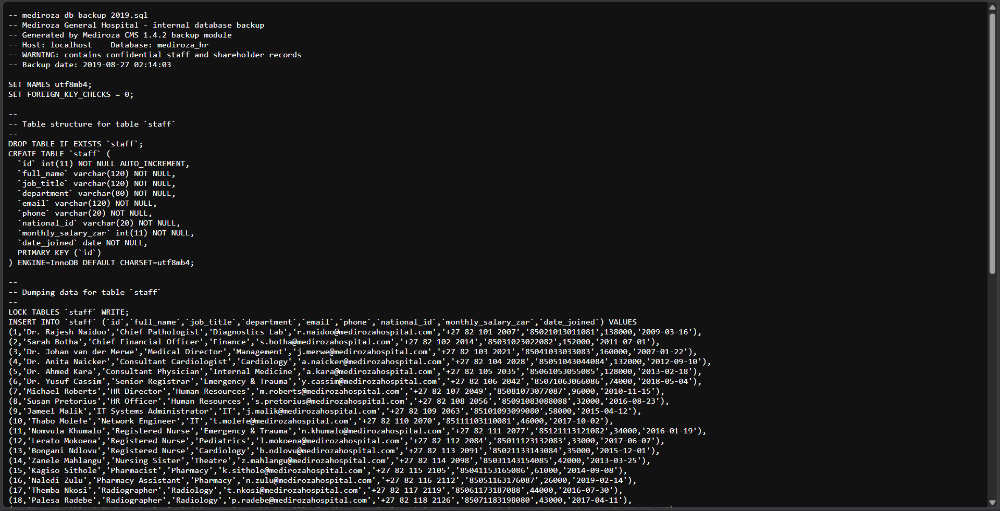

10. SQL Injection 1
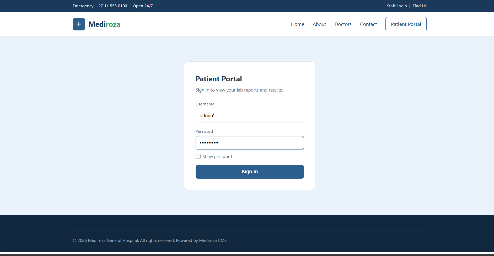

11. SQL Injection 2
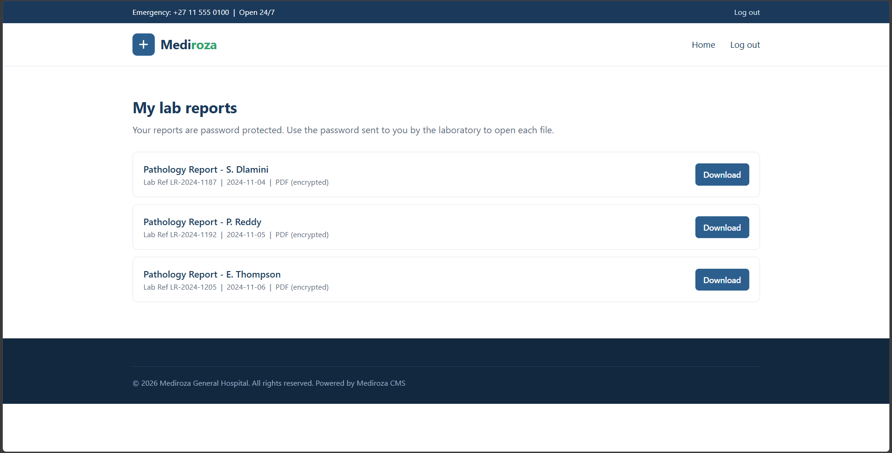

12. PDF 1
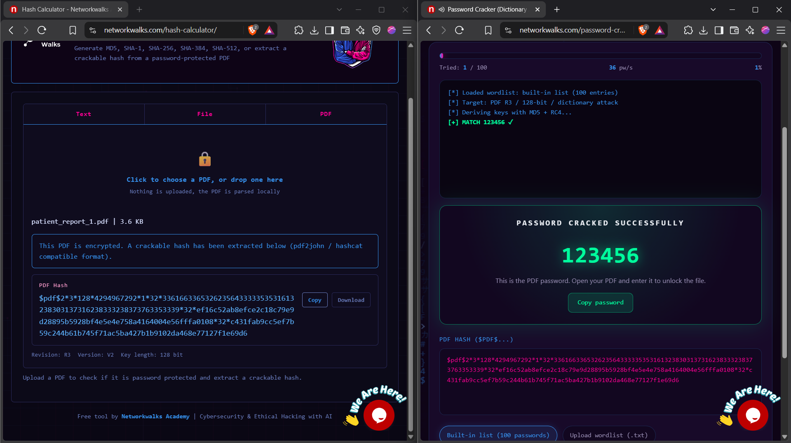

13. PDF 2
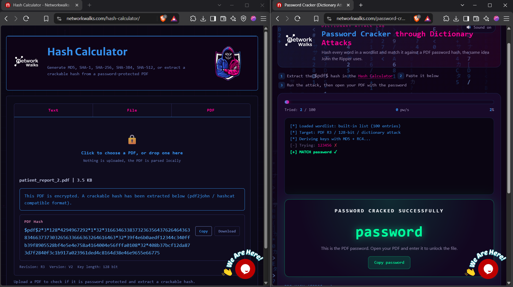

14. Nmap 1
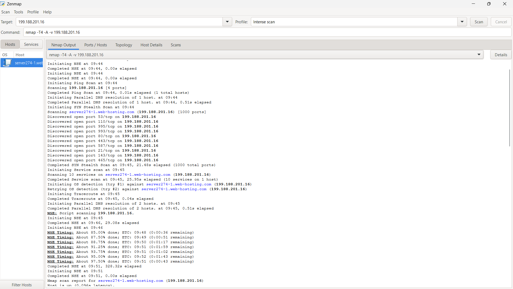

15. Nmap 2
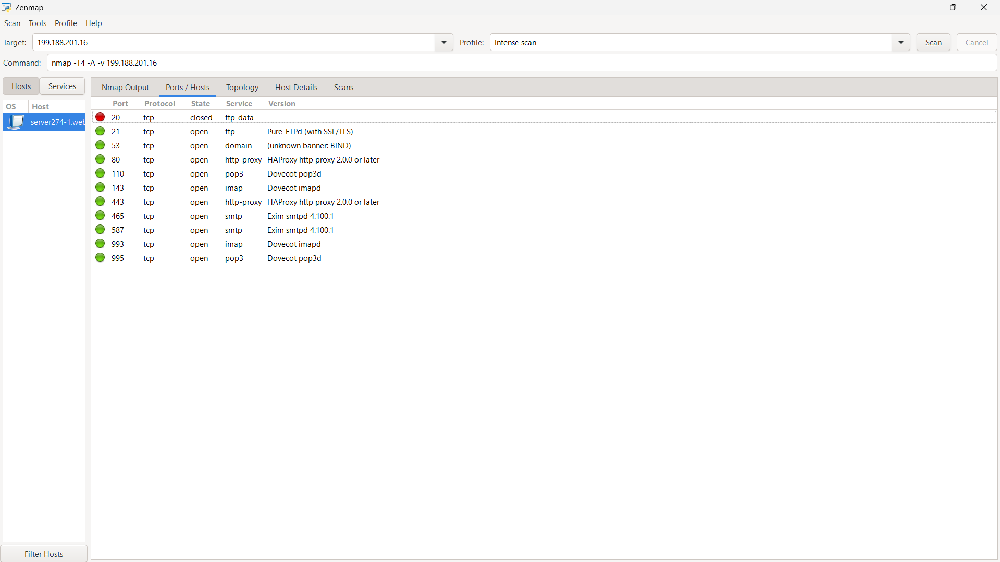

16. Nmap 3
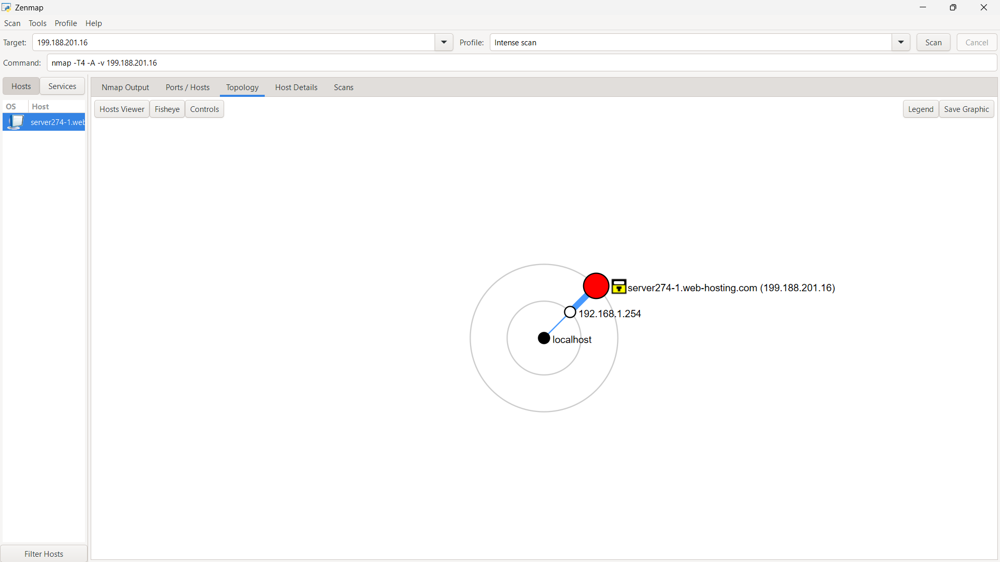

17. Nmap 4
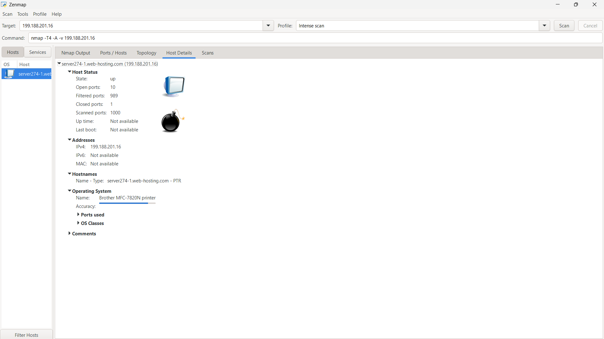

## 4. Privacy Violation and Major Threat
**PDF Cracking Analysis:**
All 3 PDFs were password-protected. Hashes were extracted and cracked successfully, proving weak passwords were used for sensitive medical reports.

- PDF 1 - Password cracked: `123456`
- PDF 2 - Password cracked: `password`
- PDF 3 - Password cracked: `!@#$%^&`

After cracking, decrypted patient content was exposed, confirming patient privacy violation.

**Risk:** Patient reports are publicly downloadable. Exposure of medical reports violates patient privacy.

**Recommendation:** Remove public access to patient reports. Protect PDFs with strong passwords and proper access control.

## 5. Conclusion Remarks
This final assessment marks the ending of my one month online internship at Network Walks Pvt. Ltd. 
The main priority is to fix Directory Indexing, Database Backup Exposure , and SQL Injection immediately, as they expose hospital internal directories, allow login bypass, and expose a full confidential database backup.  
With that asserted, I've learned quite great techniques of VAPT from this internship.
